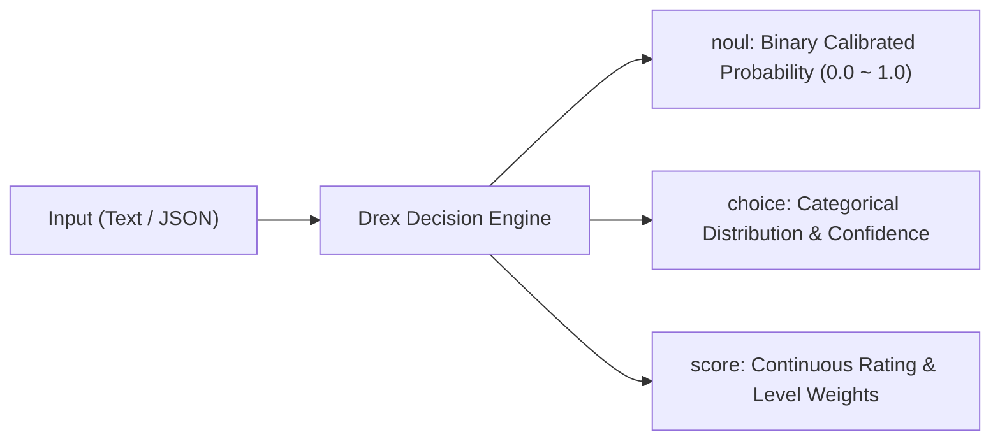

<div align="center">

**English** · [简体中文](docs/readme/README.zh-CN.md)

# nace-kit: Production-Grade Drex Decision & Classification Toolkit

### Multi-Key Failover · 0.08ms Deterministic Cache · Rich Presets · CLI & Native MCP Server

**Classify text and JSON with mathematical calibrated probabilities in milliseconds — zero 429 downtime, zero redundant bills.**

[](https://pypi.org/project/nace-kit/)
[](https://pypi.org/project/nace-kit/)
[](https://modelcontextprotocol.io/)
[](https://agentskills.io)
[](https://skills.sh/lincong1987/nace-kit/nace-kit)
[](https://github.com/lincong1987/nace-kit/actions)
[](LICENSE)

<br />

<code>pip install nace-kit</code> &nbsp;·&nbsp; <code>uvx nace-kit-mcp</code> &nbsp;·&nbsp; <code>npx skills add lincong1987/nace-kit</code>

<br /><br />

[Understand in 3 Seconds](#understand-nace-kit-in-3-seconds) · [Quick Start](#quick-start) · [Architecture & How It Works](#architecture--how-it-works) · [Comparison with Official SDK](#comparison-with-the-official-sdk) · [Question Types](#three-question-types) · [Agent Setup (MCP & Skill)](#agent-setup-mcp--skill) · [Document Pipeline](#document-pipeline-docs-extra) · [FAQ](#faq) · [Community & Contact](#community--contact)

</div>

> [!IMPORTANT]
> **Community Project**: This repository is an independent open-source production-readiness suite and is not affiliated with or endorsed by Nace AI.
> Install only from official releases on PyPI ([`nace-kit`](https://pypi.org/project/nace-kit/)) and GitHub ([`lincong1987/nace-kit`](https://github.com/lincong1987/nace-kit)). For the official minimal Python SDK and MCP server, see [`nace-sdk`](https://pypi.org/project/nace-sdk/) and [`nace-mcp`](https://pypi.org/project/nace-mcp/).

<div align="center">

<br />


<br /><br />

<table aria-label="nace-kit Community & Contact">
<tr>
<td align="center" width="380">
  <a href="#community--contact">
    <br />
    <strong>Join Developer Community / Contact Author</strong>
  </a><br />
  <sub>WeChat ID: <code>0x5f375a86</code> (Note <code>nace-kit</code>) · Q&A · Discussions · Feedback</sub>
</td>
</tr>
</table>

<br />

</div>

---

## Understand nace-kit in 3 Seconds

When routing tickets, moderating content, triaging user reports, or letting AI agents take branch actions, traditional LLMs are **slow (2–5 seconds), token-hungry, and produce hallucinated confidence scores with zero mathematical calibration**.

[nace.ai](https://nace.ai)'s **Drex decision engine** (System One classifier) changes the game: it supports 131K character states, evaluates in ~47ms, and returns statistically **calibrated probabilities (0.0 to 1.0)**.

**However, running Drex in real-world production or agent loops introduces severe operational friction:**
* 🛑 **429 Rate Limit crashes**: A single API key hitting rate limits or running out of quota abruptly halts your agent loop;
* 💸 **Redundant billing & latency**: Re-running duplicate tickets or regression test suites burns upstream credits and adds hundreds of milliseconds of network latency;
* 🧩 **Friction for AI Agents**: Writing raw JSON Schemas by hand is tedious and lacks standard MCP/Skill integration.

**`nace-kit` is the production operations layer designed to solve all of these challenges:**

* 🔑 **Smart Multi-Key Pool & Zero-Downtime Failover**: Seamlessly pool multiple API keys. On `401` (expired/bad key) or `429` (quota exhaustion), **nace-kit hot-swaps to the next key mid-request**, keeping agents alive 24/7.
* ⚡ **Deterministic Local LRU Cache**: Drex outputs are mathematically deterministic for identical inputs. Cached calls return in **0.08ms (down from 1800ms) with $0 upstream cost**.
* 📦 **Up to 512 Questions in ONE Batch**: Batch urgency, severity, routing, and sentiment into a single HTTP payload to slash round-trip network overhead.
* 🤖 **Turnkey MCP Server & Agent Skill**: Seamless integration for Claude Code, Antigravity, Cursor, Codex, and ZCode out of the box.

---

## Quick Start

### 1. Installation & Environment

```bash
pip install nace-kit        # or: uv add nace-kit

# Configure a pool of keys (comma-separated; automatically fails over on 401 / 429)
export NACE_API_KEYS="nace_sk_prod_1...,nace_sk_prod_2...,nace_sk_prod_3..."
# Or a single key: export NACE_API_KEY="nace_sk_..."
```

### 2. Python Usage

Get started with typed presets without wrestling with raw JSON:

```python
from nace_kit import NaceClient, presets

# Defaults to drex-latest and loads the NACE_API_KEYS pool
client = NaceClient()

# ① Binary question -> calibrated probability of YES
res = client.classify("Help! My payouts have been failing for 3 days and customers are leaving!", presets.urgency())
print(f"Urgency probability: {res.answers['is_urgent'].noul:.4f}")
# Output: Urgency probability: 0.8235 (82.35% calibrated urgency)

# ② Batch questions on arbitrary JSON state (ONE HTTP roundtrip)
ticket = {
    "ticket_id": "#4096",
    "customer_tier": "Enterprise",
    "title": "Database connection pool exhausted during peak sales"
}
batch_res = client.classify(ticket, [
    presets.urgency(),      # binary probability (noul: 0~1)
    presets.severity(),     # ordered severity score (score: 0~3)
    presets.priority(),     # priority label choice (choice: low/medium/high/urgent)
])

print("Severity Score:", batch_res.answers["severity"].score)        # e.g. 2.78
print("Priority Label:", batch_res.answers["priority"].choice)       # e.g. "urgent"
print("Per-key Usage:", client.usage)
# Output: {'nace_sk_prod_1…': {'calls': 2, 'input_tokens': 168, 'output_tokens': 210}, ...}
```

> **Async Native**: Import `from nace_kit import AsyncNaceClient` for 100% feature-parity in async event loops.

### 3. Command Line Interface (CLI)

Run classification directly from the terminal or shell pipelines:

```bash
# 1. Default urgency check (clean JSON output)
nace-kit "Payment checkout API returning 500 error"

# 2. Choice classification: label matching with full probability distribution
nace-kit "I want an immediate refund, you billed me twice!" \
  --ask "What department should handle this?" \
  --kind choice \
  --options billing:"payment, refund, billing issues" technical:"bugs and downtime" account:"logins"

# 3. Score rating: evaluate customer sentiment level
nace-kit "I have been waiting for two weeks with no reply. Unacceptable!" \
  --ask "How angry is the customer?" \
  --kind score \
  --levels calm annoyed angry furious

# 4. Check available models & key health
nace-kit --models
```

<div align="center">
<br />

<br />
<sub>Real-world run: Initial cold request takes ~1200ms; duplicate request hits local deterministic cache in 0.08ms!</sub>
<br /><br />
</div>

---

## Architecture & How It Works

`nace-kit` acts as an enterprise-grade operational resilience layer between your application/agents and the upstream Drex API:

<div align="center">
<br />

<br /><br />
</div>

### 1. Failover & Resilience Matrix

| Error Type | Trigger Condition | nace-kit Behavior |
|---|---|---|
| **401 / 403** | Dead or invalid API key | **Instant rotation** to the next key in the pool, retrying the request |
| **429 (Rate Limit)** | Quota exceeded (multi-key pool) | **Instant rotation** to the next available key, avoiding downtime |
| **429 (Rate Limit)** | Quota exceeded (single key) | Respects `Retry-After` header with exponential backoff & jitter |
| **408 / 5xx / Network Timeout** | Upstream blip or connection timeout | Exponential backoff + jitter within a 30s budget, then rotates |
| **4xx (Bad Payload)** | Malformed JSON or rejected parameters | Immediately raises `NaceBadRequest` (no wasteful retries) |

### 2. Deterministic Cache Benchmark

Because Drex responses are mathematically deterministic for identical inputs (`model` + `state` + `questions`), `nace-kit` caches results locally:

```text
First call:             1896.7 ms  (Upstream network + ~47ms server inference; billed once)
Second call (Cache):       0.08 ms (Memory hit: 23,000x faster, $0 cost)
```

> **Tip**: Pass `cache_size=0` in Python or `--no-cache` in CLI to bypass the cache when needed.

---

## Comparison with the Official SDK

| Feature | Official `nace-sdk` | `nace-kit` | Production Benefit |
|---|:---:|:---:|---|
| **Classification API**<br><sub>(3 question types, any-JSON state, typed schemas)</sub> | ✅ | ✅ | 100% compatible syntax, painless migration |
| **Multi-Key Pool & Hot Failover** | ❌ Single key only | **✅ Core Feature** | Protects agent loops from 429 quota exhaustion |
| **Deterministic Local LRU Cache** | ❌ Every call hits network | **✅ Core Feature** | 0.08ms latency on duplicates; zero redundant billing |
| **Per-Key Usage Metering** | ❌ Not available | **✅ `client.usage`** | Real-time call count and token breakdown per key |
| **Jitter Backoff & Budget Protection** | ✅ Basic backoff | **✅ Combined with Rotation** | Retries gracefully, then moves to next key |
| **Built-in Presets** | ❌ Write prompt manually | **✅ Out of the box** | `urgency()`, `severity()`, `priority()`, `sentiment()` |
| **Batching (up to 512 questions)** | ✅ Supported | **✅ Enhanced** | High-level ergonomics & validated mapping |
| **Document Pipeline (`[docs]`)** | ✅ Official support | **✅ Key-Pool Wrapped** | Key pool rotation + idempotency key protection |
| **Standalone CLI Tool** | ❌ login only | **✅ Built-in** | Quick testing, shell piping, smoke checks |
| **AI Agent MCP Server** | ❌ Separate `nace-mcp` | **✅ All-in-one** | `uvx nace-kit-mcp` works instantly |
| **Standard Agent Skill (`SKILL.md`)** | ❌ Not provided | **✅ Turnkey install** | `nace-kit --install-skill` for Claude / Antigravity |

---

## Three Question Types

Drex answers questions with rigorous calibrated probabilities across three question models:



### 1. `noul` (Binary Probability)
Answers with a precise float between `0.0` and `1.0` representing the calibrated probability that the condition is true.

```python
from nace_kit import presets as p

q = p.noul("Does the user demand a refund?", true="explicit refund request or payment dispute")
res = client.classify("Your tool is completely broken, refund my card right now!", q)
print(res.answers["answer"].noul)  # 0.9821 -> High probability of refund request
```

### 2. `choice` (Categorical Classification)
Selects the best matching label and provides the full probability distribution across all choices.

```python
q = p.choice("What domain does this ticket belong to?", {
    "billing": "Invoices, double charges, payment methods, refunds",
    "technical": "Server 500, bugs, network downtime, crashes",
    "account": "Password reset, email changes, profile settings"
})
res = client.classify("I forgot my password and my registered email is deactivated.", q)
ans = res.answers["answer"]
print(ans.choice)           # "account"
print(ans.confidence)       # 0.9412
print(ans.probabilities)    # {'account': 0.96, 'billing': 0.02, 'technical': 0.02}
```

### 3. `score` (Ordered Level Rating)
Scores intensity across an ordered progression (e.g., severity levels, anger scales), producing an expected numeric rating.

```python
q = p.score("How angry is the customer?", ["calm", "annoyed", "angry", "furious"])
res = client.classify("This is the third time I am reporting this. Why has nobody fixed it?!", q)
ans = res.answers["answer"]
print(ans.score)            # 1.68 (between annoyed(1) and angry(2))
print(ans.probabilities)    # Breakdown across all 4 levels
```

> [!TIP]
> **Calibrated Probabilities vs Verdicts**:
> Unlike binary LLM outputs, calibrated probabilities provide real mathematical risk measures. Choose your own thresholds to match your SLA:
> * `noul > 0.85`: Automatically escalate ticket to P1 on-call.
> * `0.50 <= noul <= 0.85`: Queue for human review.
> * `noul < 0.50`: Standard automated resolution.

---

## Agent Setup (MCP & Skill)

`nace-kit` natively implements the [Model Context Protocol (MCP)](https://modelcontextprotocol.io/) and the [Agent Skills standard](https://agentskills.io/).

### 1. Configure the MCP Server

Add `nace-kit-mcp` to your favorite agent or IDE configuration (runs immediately with `uvx` without manual installation):

<details open>
<summary><strong>Claude Code (CLI Agent)</strong></summary>

Register via CLI with a single command:

```bash
claude mcp add nace uvx nace-kit-mcp -e NACE_API_KEYS=nace_sk_prod_1...,nace_sk_prod_2...
```

Or add to your configuration file `~/.claude.json`:

```json
{
  "mcpServers": {
    "nace": {
      "command": "uvx",
      "args": ["nace-kit-mcp"],
      "env": {
        "NACE_API_KEYS": "nace_sk_prod_1...,nace_sk_prod_2..."
      }
    }
  }
}
```
</details>

<details open>
<summary><strong>Cursor (AI Code Editor)</strong></summary>

Create `.cursor/mcp.json` in your workspace root, or add via `Cursor Settings -> Features -> MCP`:

```json
{
  "mcpServers": {
    "nace": {
      "command": "uvx",
      "args": ["nace-kit-mcp"],
      "env": {
        "NACE_API_KEYS": "nace_sk_prod_1...,nace_sk_prod_2..."
      }
    }
  }
}
```
</details>

<details>
<summary><strong>Google Antigravity / Gemini CLI</strong></summary>

Add to Antigravity's global config `~/.gemini/antigravity/mcp_config.json`:

```json
{
  "mcpServers": {
    "nace": {
      "command": "uvx",
      "args": ["nace-kit-mcp"],
      "env": {
        "NACE_API_KEYS": "nace_sk_prod_1...,nace_sk_prod_2..."
      }
    }
  }
}
```
</details>

<details>
<summary><strong>Claude Desktop</strong></summary>

Edit configuration:
- **macOS**: `~/Library/Application Support/Claude/claude_desktop_config.json`
- **Windows**: `%APPDATA%\Claude\claude_desktop_config.json`

```json
{
  "mcpServers": {
    "nace": {
      "command": "uvx",
      "args": ["nace-kit-mcp"],
      "env": {
        "NACE_API_KEYS": "nace_sk_prod_1...,nace_sk_prod_2..."
      }
    }
  }
}
```
</details>

<details>
<summary><strong>Windsurf (Codeium)</strong></summary>

Edit `~/.codeium/windsurf/mcp_config.json`:

```json
{
  "mcpServers": {
    "nace": {
      "command": "uvx",
      "args": ["nace-kit-mcp"],
      "env": {
        "NACE_API_KEYS": "nace_sk_prod_1...,nace_sk_prod_2..."
      }
    }
  }
}
```
</details>

<details>
<summary><strong>Cline / Roo Code (VS Code Extension)</strong></summary>

In VS Code, open Cline Settings ➔ **MCP Servers** ➔ click **Edit in settings.json** (`cline_mcp_settings.json`):

```json
{
  "mcpServers": {
    "nace": {
      "command": "uvx",
      "args": ["nace-kit-mcp"],
      "env": {
        "NACE_API_KEYS": "nace_sk_prod_1...,nace_sk_prod_2..."
      },
      "disabled": false,
      "autoApprove": []
    }
  }
}
```
</details>

<details>
<summary><strong>Zed Editor</strong></summary>

Add to Zed settings `~/.config/zed/settings.json`:

```json
{
  "experimental.model_context_protocol": {
    "servers": {
      "nace": {
        "command": "uvx",
        "args": ["nace-kit-mcp"],
        "env": {
          "NACE_API_KEYS": "nace_sk_prod_1...,nace_sk_prod_2..."
        }
      }
    }
  }
}
```
</details>

<details>
<summary><strong>ZCode / Codex</strong></summary>

Add to `~/.zcode/cli/config.json` or `~/.codex/config.json`:

```json
{
  "mcp": {
    "servers": {
      "nace": {
        "type": "stdio",
        "command": "uvx",
        "args": ["nace-kit-mcp"],
        "env": {
          "NACE_API_KEYS": "nace_sk_prod_1...,nace_sk_prod_2..."
        }
      }
    }
  }
}
```
</details>

<details>
<summary><strong>Cherry Studio / Chatbox (GUI Clients)</strong></summary>

In the app's **MCP Settings / Plugins** interface, add a new stdio server:
* **Name**: `nace`
* **Command**: `uvx`
* **Arguments**: `nace-kit-mcp`
* **Environment**: `NACE_API_KEYS=nace_sk_prod_1...,nace_sk_prod_2...`
</details>

### 2. Natural Language Prompting Example with Agents

Restart your agent after configuration. You can now prompt the agent in natural conversation — the agent autonomously selects and triggers `nace.classify` or `nace.ask`:

> 💬 **User**: *"Analyze this customer ticket for urgency and department: 'Checkout API returning 500 continuously, enterprise accounts cannot finish payments. Immediate escalation requested!'*
>
> 🤖 **Agent (automatically calls `nace.classify`)**:
> * 🚨 **Urgency (`is_urgent`)**: `0.9328` (Calibrated probability: 93.3% urgent)
> * 🏷️ **Department (`department`)**: `technical` (Confidence: 96%)
> * 📊 **Recommendation**: Urgency exceeds 0.85 SLA threshold. Escalating to P1 on-call immediately!

### 3. Available MCP Tools

| Tool | Description | Common Usage |
|---|---|---|
| `classify` | Full batch interface | Classify any text/JSON with up to 512 custom questions |
| `ask` | Quick single-question wrapper | Fetch `noul`, `score`, or `choice` probabilities instantly |
| `list_models` | Available model list & health check | Verifies API key connectivity with zero token cost |
| `parse_document` | Document to Markdown *(needs `[docs]`)* | Converts PDF / Office files into clean structured Markdown |
| `extract_data` | Structured field extraction *(needs `[docs]`)* | Extracts JSON Schema entities from contracts or invoices |
| `get_document_job`| Job status tracker *(needs `[docs]`)* | Polls document pipeline job status |

### 4. Install the Agent Skill

If you prefer lightweight prompts over a persistent background MCP server, install the standard skill file following the [Agent Skills standard](https://agentskills.io/). It equips agents with operational heuristics for question type selection (`noul` / `choice` / `score`), batch optimization, and probability thresholds:

#### Option A: Install via skills.sh (Recommended, zero Python dependencies)
Fetch and install directly from the GitHub repository into your agent environment:
```bash
npx skills add lincong1987/nace-kit
```

#### Option B: Install via nace-kit CLI
If you already have `nace-kit` installed locally:
```bash
# Installs to global ~/.agents/skills/nace-kit/SKILL.md
nace-kit --install-skill

# Or target Claude skills (~/.claude/skills/nace-kit/SKILL.md)
nace-kit --install-skill --claude
```

#### Option C: Built-in Workspace Skill
This repository bundles [`.agents/skills/nace-kit/SKILL.md`](.agents/skills/nace-kit/SKILL.md). When opening this workspace with Claude Code, Cursor, or Antigravity, the skill is automatically discovered and ready to use.


---

## Document Pipeline (`[docs]` Extra)

To parse and extract structured data from PDF, Word, or Excel documents:

```bash
pip install "nace-kit[docs]"
```

Document operations leverage the official parsing engine with **nace-kit's multi-key failover and built-in idempotency keys** (ensuring key rotations never double-bill a document job):

```python
from nace_kit import DocsClient

docs = DocsClient()  # Uses the same NACE_API_KEYS pool

# Parse a PDF into clean Markdown
job = docs.parse("https://example.com/quarterly_report.pdf", output={"formats": ["markdown"]}, wait=120)
print(job.result["document"]["markdown"])

# Extract structured JSON Schema fields
schema = {
    "type": "object",
    "properties": {
        "total": {"type": "number"},
        "vendor": {"type": "string"}
    },
    "required": ["total", "vendor"]
}
extract_job = docs.extract("https://example.com/invoice.pdf", schema=schema, wait=60)
print("Extracted fields:", extract_job.result["fields"])
```

---

## FAQ

<details>
<summary><strong>Q: Is the local cache safe for production?</strong></summary>

Yes. Drex classification models are mathematically deterministic. Given the exact same model, state payload, and question set, the output is identical. `nace-kit` computes a strict cryptographic hash of the request payload; a cache hit returns the exact same data as a network call, but in 0.08ms at $0 cost. Pass `cache_size=0` or `--no-cache` to force network calls.
</details>

<details>
<summary><strong>Q: Which model does nace-kit call by default?</strong></summary>

By default, calls route to `drex-latest` (currently pointing to `drex-v2.0`, a Mixture-of-Experts model with 3B active parameters supporting up to 131,072 token states). If you require strict reproducibility across future model upgrades, pin the version explicitly via `NaceClient(model="drex-v2.0")`.
</details>

<details>
<summary><strong>Q: Where should I put API keys?</strong></summary>

Store them in the `NACE_API_KEYS` environment variable as a comma-separated list. For agents, define them inside the MCP server configuration's `env` block. Never hardcode API keys in source code.
</details>

<details>
<summary><strong>Q: What happens if all keys in the pool hit 429?</strong></summary>

`nace-kit` cycles through all configured keys. If all keys report 429, it applies exponential backoff with jitter, honoring the `Retry-After` header up to the configured retry budget (default 30 seconds). If all keys remain unavailable after the budget expires, it raises an actionable diagnostic error.
</details>

---

## Contributing

We welcome contributions, bug reports, and showcase examples!

```bash
git clone https://github.com/lincong1987/nace-kit.git
cd nace-kit

# Install dependencies using uv
uv sync

# Run tests (100% mocked; no network or live API keys needed)
uv run pytest --basetemp=.tmp/pytest
```

---

## Community & Contact

Connect with fellow developers to discuss Drex best practices, high-concurrency production orchestration, and AI agent architectures:

<div align="center">

<table style="border: 1px solid #30363d; border-radius: 12px; padding: 16px; background-color: #161b22;">
<tr>
<td align="center" width="280" style="border: none; vertical-align: middle;">
  
  <br /><br />
  <strong>Scan to connect on WeChat</strong><br />
  <sub>WeChat ID: <code>0x5f375a86</code> (Curacao / 库拉索)</sub><br />
  <sub>Note: <code>nace-kit</code></sub>
</td>
<td align="left" width="400" style="border: none; padding-left: 24px; vertical-align: middle;">
  <h3>💬 Discussions · Q&A · Collaboration</h3>
  <ul>
    <li>🚀 <strong>Engineering Discussions</strong>: Drex API high-availability scheduling, probability calibration, and key pooling</li>
    <li>🤖 <strong>Agent Practices</strong>: Building robust agent tools with MCP and Skills on Claude Code / Cursor / Antigravity</li>
    <li>💡 <strong>Feature Suggestions</strong>: Propose feature requests or share your production use cases</li>
    <li>🐛 <strong>Bug Reports</strong>: Open an issue on <a href="https://github.com/lincong1987/nace-kit/issues">GitHub Issues</a></li>
  </ul>
</td>
</tr>
</table>

</div>

---

## License

[MIT](LICENSE) © nace-kit contributors.
