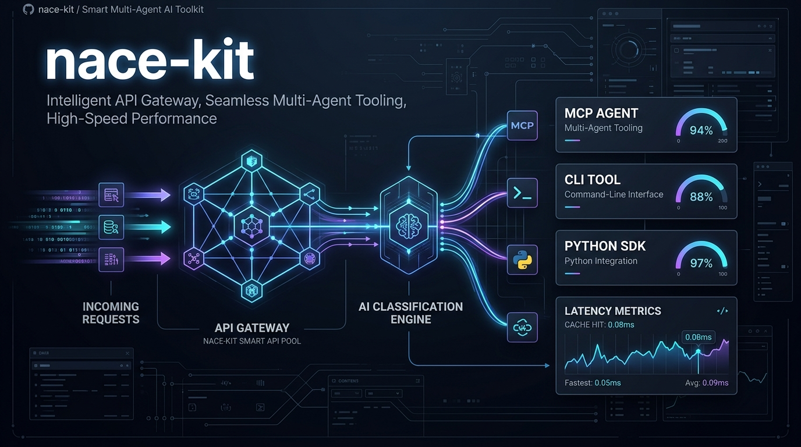
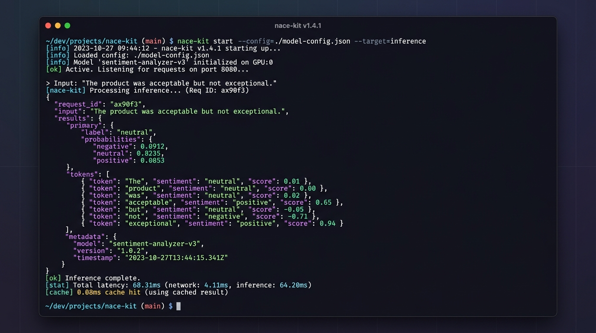
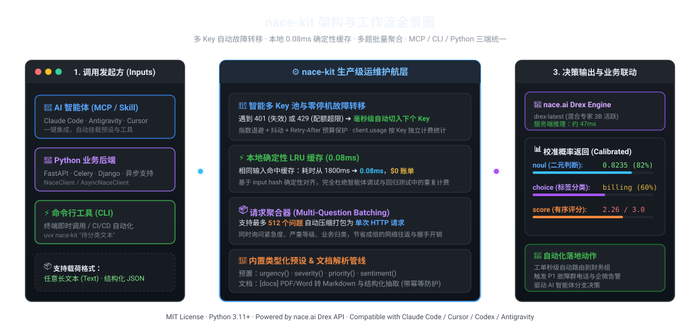
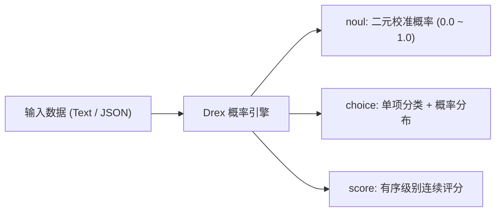

<div align="center">

[English](../../README.md) · **简体中文**

# nace-kit：生产级 Drex 决策与概率分类增强库

### 多 Key 自动轮转 · 0.08ms 确定性缓存 · 预设模板 · CLI 与原生 MCP 服务一体化

**用数学级校准概率（Calibrated Probabilities）毫秒级决策文本与 JSON，告别 429 配额中断与重复账单。**

[](https://pypi.org/project/nace-kit/)
[](https://pypi.org/project/nace-kit/)
[](https://modelcontextprotocol.io/)
[](https://agentskills.io)
[](https://skills.sh/lincong1987/nace-kit/nace-kit)
[](https://github.com/lincong1987/nace-kit/actions)
[](../../LICENSE)

<br />

<code>pip install nace-kit</code> &nbsp;·&nbsp; <code>uvx nace-kit-mcp</code> &nbsp;·&nbsp; <code>npx skills add lincong1987/nace-kit</code>

<br /><br />

[3秒了解 nace-kit](#3秒了解-nace-kit) · [快速开始](#快速开始) · [架构与工作原理](#架构与工作原理) · [与官方-sdk-对比](#与官方-sdk-对比) · [三大核心问题类型](#三大核心问题类型) · [智能体集成指南](#智能体集成指南-mcp--skill) · [文档管线](#文档管线-docs-可选依赖) · [常见问题](#常见问题) · [交流与联系](#交流与联系)

</div>

> [!IMPORTANT]
> **社区开源项目**：本项目为面向高可用生产运维与智能体打造的增强套件，与 Nace AI 官方无隶属或商业背书关系。
> 请认准官方 PyPI 发行包（[`nace-kit`](https://pypi.org/project/nace-kit/)）与 GitHub 源码仓库（[`lincong1987/nace-kit`](https://github.com/lincong1987/nace-kit)）；名称相似的非官方镜像请谨慎辨别。官方原生基础 SDK 与 MCP 服务请查阅 [`nace-sdk`](https://pypi.org/project/nace-sdk/) 及 [`nace-mcp`](https://pypi.org/project/nace-mcp/)。

<div align="center">

<br />



<br /><br />

<table aria-label="nace-kit 社区与联系">
<tr>
<td align="center" width="380">
  <a href="#交流与联系">
    <br />
    <strong>加入开发者交流群 / 联系作者</strong>
  </a><br />
  <sub>微信号：<code>0x5f375a86</code>（备注 <code>nace-kit</code>）· 答疑 · 经验交流 · 需求反馈</sub>
</td>
</tr>
</table>

<br />

</div>

---

## 3秒了解 nace-kit

在构建工单路由、风险拦截、情感分析或 AI 智能体（Agent）工作流时，传统大模型往往**响应慢（2-5秒）、消耗海量 Token，且输出的所谓“置信度”常常是未经校准的模型幻觉**。

[nace.ai](https://nace.ai) 推出的 **Drex 决策模型**（System One 分类引擎）改变了这一切：它拥有 131K 字符超长上下文，单次服务端推理仅需 ~47ms，并输出具备严格统计学意义的**校准概率（Calibrated Probabilities）**。

**然而，在生产环境落地与智能体长程运行中，开发者常常面临工程难题：**
* 🛑 **频繁 429 宕机**：单 API Key 遭遇突发流量或配额耗尽，直接导致下游链路瘫痪；
* 💸 **重复扣费与延迟**：相同的测试样本、重复工单反复请求 API，浪费账单且增加数百毫秒网络耗时；
* 🧩 **智能体整合繁琐**：需要手动拼装复杂 JSON Schema，缺乏标准 MCP 工具和 Agent 指引。

**`nace-kit` 正是为解决这些痛点而生的运维级生产套件：**

* 🔑 **多 Key 动态池与无感故障转移**：配置多个 API Key，遇到 `401`（失效）或 `429`（配额超限）**在请求中途毫秒级自动切换到下一个可用 Key**，保障智能体 7x24h 永不掉线。
* ⚡ **本地确定性 LRU 缓存**：Drex 的相同输入具有严格确定性。命中缓存时**响应时间从 1800ms 降至 0.08ms，上游账单直降 100%（$0 成本）**。
* 📦 **512 题单次打包聚合**：支持将紧急度、严重等级、责任归属等最多 512 个分类问题打包进**单次 HTTP 请求**，大幅削减网络开销。
* 🤖 **原生 MCP 服务与 Agent Skill 同包直达**：全面适配 Claude Code、Antigravity、Cursor、Codex、ZCode 等各类智能体。

---

## 快速开始

### 1. 安装与环境变量

```bash
# 推荐使用 pip 或 uv 安装
pip install nace-kit

# 配置 Key 池（多个 Key 逗号分隔，遭遇 429/401 自动无感轮转）
export NACE_API_KEYS="nace_sk_prod_1...,nace_sk_prod_2...,nace_sk_prod_3..."
# 若仅有一个 Key，亦可直接使用：export NACE_API_KEY="nace_sk_..."
```

### 2. Python 极速上手

无需繁琐定义 Schema，使用内置预设开箱即用：

```python
from nace_kit import NaceClient, presets

# 默认使用 drex-latest，自动加载 NACE_API_KEYS 池
client = NaceClient()

# ① 单个判断：是否紧急？直接返回 0~1 的校准概率
res = client.classify("救命！生产环境结算接口已持续报错3天，客户正在大批量流失！", presets.urgency())
print(f"紧急度概率: {res.answers['is_urgent'].noul:.4f}")
# 输出: 紧急度概率: 0.8235 (82.35% 确定性紧急)

# ② 批量聚合：输入可以是任意结构化 JSON，多问题一次往返解决
ticket = {
    "ticket_id": "#4096",
    "customer_tier": "Enterprise",
    "title": "Database connection pool exhausted during peak sales"
}
batch_res = client.classify(ticket, [
    presets.urgency(),      # 紧急度 (noul: 0~1)
    presets.severity(),     # 严重等级 (score: 0~3)
    presets.priority(),     # 优先级分级 (choice: low/medium/high/urgent)
])

print("严重分值:", batch_res.answers["severity"].score)        # e.g. 2.78
print("优先级别:", batch_res.answers["priority"].choice)       # e.g. "urgent"
print("按 Key 用量审计:", client.usage)
# 输出: {'nace_sk_prod_1…': {'calls': 2, 'input_tokens': 168, 'output_tokens': 210}, ...}
```

> **异步原生支持**：只需导入 `from nace_kit import AsyncNaceClient`，API 与体验完全对齐。

### 3. 命令行即时体验 (CLI)

`nace-kit` 自带开箱即用的命令行工具，支持管道与即时分类测试：

```bash
# 1. 默认紧急度探测（输出纯净 JSON）
nace-kit "接口返回 500 导致用户无法支付订单"

# 2. 单项分类 (choice)：自动根据业务标签计算概率分布
nace-kit "我要申请退款，扣费扣了两次！" \
  --ask "该工单应分配给哪个部门？" \
  --kind choice \
  --options billing:"支付、扣费与退款" technical:"技术故障与Bug" account:"账号与登录"

# 3. 有序等级评估 (score)：评估用户愤怒指数
nace-kit "等了两个星期还没有回复，再不解决我就投诉到消协！" \
  --ask "用户愤怒程度如何？" \
  --kind score \
  --levels calm annoyed angry furious

# 4. 可用模型自检与 Key 健康度探测
nace-kit --models
```

<div align="center">
<br />

<br />
<sub>实测：首次冷启动 1200ms 上游响应；相同请求二次执行触发本地确定性缓存，耗时仅 0.08ms！</sub>
<br /><br />
</div>

---

## 架构与工作原理

`nace-kit` 作为应用与 Drex 上游之间的高可用护航层，将原本脆弱的单点 API 包装为具备**自动容灾、本地纳秒级缓存、智能聚合**的企业级组件：

<div align="center">
<br />

<br /><br />
</div>

### 1. 智能容灾与故障转移矩阵

在长程 Agent 执行或后台高并发作业中，单个 API 错误不应中断流程。`nace-kit` 采取严谨的故障决策策略：

| 异常类型 | 触发条件 | nace-kit 自动化行为 |
|---|---|---|
| **401 / 403** | API Key 失效或权限不足 | **零延迟瞬间轮转**至 Key 池中下一个 Key，重试该请求 |
| **429 (Rate Limit)** | 配额耗尽（配置了多 Key 时） | **零延迟瞬间轮转**至下一张卡，避免业务出现 429 熔断 |
| **429 (Rate Limit)** | 配额耗尽（仅配单 Key 时） | 严格遵循响应头 `Retry-After`，配合指数退避与随机抖动重试 |
| **408 / 5xx / 网络超时** | 上游瞬时波动、连接中断 | 指数退避抖动重试（默认 30s 整体时间预算），耗尽后自动切下一 Key |
| **4xx (请求体错误)** | 参数格式非法、字段不匹配 | 立即抛出明确异常 `NaceBadRequest`，不进行无效重试 |

### 2. 确定性缓存实测性能对比

Drex 模型对于相同的输入载荷（Model + State + Questions）计算结果完全确定。`nace-kit` 利用这一物理特性内置了本地 LRU 缓存：

```text
First call:             1896.7 ms  (上游服务端计算耗时 ~47ms + 网络传输，计费 1 次)
Second call (Cache):       0.08 ms (直接内存直出，耗时提升 23,000+ 倍，计费 $0)
```

> **提示**：如需在生产中禁用缓存获取绝对实时链路测试，可在 Python 中设置 `NaceClient(cache_size=0)` 或在 CLI 中追加 `--no-cache` 参数。

---

## 与官方 SDK 对比

| 能力项 | 官方 `nace-sdk` | `nace-kit` | 生产优势 |
|---|:---:|:---:|---|
| **基础分类 API**<br><sub>(三种题型、任意 JSON、类型化支持)</sub> | ✅ | ✅ | 语法高度一致，零心智负担平滑迁移 |
| **多 Key 动态池与无感故障转移** | ❌ 仅支持单 Key | **✅ 核心支持** | 告别 429 配额中断，多团队/多账号额度无缝聚合 |
| **本地确定性 LRU 缓存** | ❌ 每次必发起请求 | **✅ 核心支持** | 调试重复输入耗时降至 0.08ms，杜绝浪费账单 |
| **按 Key 细粒度用量监控** | ❌ 无统计 | **✅ `client.usage`** | 实时查看各 Key 的调用次数与 Token 开销，审计无忧 |
| **智能退避与 Retry-After 预算保护** | ✅ 基础退避 | **✅ 结合 Key 轮转** | 抖动退避重试，超时自动迁移至下一个 Key |
| **常用领域预设模板 (Presets)** | ❌ 需自写 Prompt | **✅ 开箱即用** | 提供 `urgency()`、`severity()`、`priority()`、`sentiment()` 等预设 |
| **多达 512 题请求批处理** | ✅ 基础支持 | **✅ 深度优化** | 自动校验批量限制并统一解包映射 |
| **文档解析与抽取管线** | ✅ 官方支持 | **✅ 包装 Key 池** | 统一享受多 Key 轮转容灾，带客户端幂等防护 |
| **CLI 命令行工具** | ❌ 仅登录 | **✅ 同包内置** | 终端直调、Shell 管道集成、快速验证模型 |
| **AI 智能体 MCP 服务** | ❌ 独立库 `nace-mcp` | **✅ 一体化内置** | `uvx nace-kit-mcp` 一键即跑，无依赖冲突 |
| **Agent Skill 标准生态安装** | ❌ 不提供 | **✅ 一键安装** | `nace-kit --install-skill` 直装 Claude/Antigravity |

---

## 三大核心问题类型

Drex 并非简单的文本生成器，而是专业的结构化概率评估器。`nace-kit` 全面支持其三种原生题型：



### 1. `noul`（二元判断，速度极快）
输出一个 `0.0` 到 `1.0` 之间的精确浮点数，代表命题为真的**校准概率**。适合过滤、拦截、报警判定。

```python
from nace_kit import presets as p

# 判定是否需要退款
q = p.noul("用户是否明确或暗示要求退款？", true="明确索要退款或对收费提出异议")
res = client.classify("买了你们软件根本用不了，赶紧把钱退给我！", q)
print(res.answers["answer"].noul)  # 0.9821 -> 高度确定需要退款
```

### 2. `choice`（多标签分类与全概率分布）
在互斥选项中选出最匹配的一项，并返回每个选项的概率分布以及置信度指标。

```python
# 工单智能分流
q = p.choice("该工单属于哪个业务领域？", {
    "billing": "涉及发票、扣费异常、支付手段、退款等财务事项",
    "technical": "代码报错、服务器 500、无法连接、接口崩溃等技术故障",
    "account": "修改密码、更换手机号、账号解绑等个人信息变更"
})
res = client.classify("我的账户密码忘记了，绑定的手机号已经停用", q)
ans = res.answers["answer"]
print(ans.choice)           # "account"
print(ans.confidence)       # 0.9412
print(ans.probabilities)    # {'account': 0.96, 'billing': 0.02, 'technical': 0.02}
```

### 3. `score`（有序等级评估）
为具备顺序强弱的指标（如等级、情绪、危险度）打分。模型不仅返回最贴近的级别，还给出连续期望分值。

```python
# 客户情绪危险分级
q = p.score("评估用户的负面情绪强度", ["calm", "annoyed", "angry", "furious"])
res = client.classify("这已经是我第三次催促进度了，你们效率到底行不行？", q)
ans = res.answers["answer"]
print(ans.score)            # 1.68 (介于 annoyed(1) 与 angry(2) 之间)
print(ans.probabilities)    # 各级别的详细概率权重
```

> [!TIP]
> **如何科学使用校准概率？**
> 校准概率不是“是/否”的绝对裁决，而是精确的风险度量。在实际业务中，建议根据容忍度自主设定门槛。例如：
> * `noul > 0.85`：直接触发短信自动化预警；
> * `0.50 <= noul <= 0.85`：送入人工客服审核流；
> * `noul < 0.50`：常规低优先级流转。

---

## 智能体集成指南 (MCP & Skill)

`nace-kit` 原生支持业界标准的 [Model Context Protocol (MCP)](https://modelcontextprotocol.io/) 与 [Agent Skills 规范](https://agentskills.io/)。

### 1. 配置 MCP Server

选择你常用的智能体或编辑器，添加配置即可快速启用（支持通过 `uvx` 免安装直接运行）：

<details open>
<summary><strong>Claude Code (CLI 智能体)</strong></summary>

使用命令行一行快速注册：

```bash
claude mcp add nace uvx nace-kit-mcp -e NACE_API_KEYS=nace_sk_prod_1...,nace_sk_prod_2...
```

或直接写入配置文件 `~/.claude.json`：

```json
{
  "mcpServers": {
    "nace": {
      "command": "uvx",
      "args": ["nace-kit-mcp"],
      "env": {
        "NACE_API_KEYS": "nace_sk_prod_1...,nace_sk_prod_2..."
      }
    }
  }
}
```
</details>

<details open>
<summary><strong>Cursor (AI 代码编辑器)</strong></summary>

在项目根目录下创建 `.cursor/mcp.json`，或在全局 `Cursor Settings -> Features -> MCP` 中添加：

```json
{
  "mcpServers": {
    "nace": {
      "command": "uvx",
      "args": ["nace-kit-mcp"],
      "env": {
        "NACE_API_KEYS": "nace_sk_prod_1...,nace_sk_prod_2..."
      }
    }
  }
}
```
</details>

<details>
<summary><strong>Google Antigravity / Gemini CLI</strong></summary>

在 Antigravity 全局配置文件 `~/.gemini/antigravity/mcp_config.json` 中配置：

```json
{
  "mcpServers": {
    "nace": {
      "command": "uvx",
      "args": ["nace-kit-mcp"],
      "env": {
        "NACE_API_KEYS": "nace_sk_prod_1...,nace_sk_prod_2..."
      }
    }
  }
}
```
</details>

<details>
<summary><strong>Claude Desktop (桌面客户端)</strong></summary>

编辑配置文件：
- **macOS**: `~/Library/Application Support/Claude/claude_desktop_config.json`
- **Windows**: `%APPDATA%\Claude\claude_desktop_config.json`

```json
{
  "mcpServers": {
    "nace": {
      "command": "uvx",
      "args": ["nace-kit-mcp"],
      "env": {
        "NACE_API_KEYS": "nace_sk_prod_1...,nace_sk_prod_2..."
      }
    }
  }
}
```
</details>

<details>
<summary><strong>Windsurf (Codeium)</strong></summary>

编辑配置文件 `~/.codeium/windsurf/mcp_config.json`：

```json
{
  "mcpServers": {
    "nace": {
      "command": "uvx",
      "args": ["nace-kit-mcp"],
      "env": {
        "NACE_API_KEYS": "nace_sk_prod_1...,nace_sk_prod_2..."
      }
    }
  }
}
```
</details>

<details>
<summary><strong>Cline / Roo Code (VS Code 扩展)</strong></summary>

在 VS Code 中打开 Cline 设置 ➔ **MCP Servers** ➔ 点击 **Edit in settings.json**（`cline_mcp_settings.json`）：

```json
{
  "mcpServers": {
    "nace": {
      "command": "uvx",
      "args": ["nace-kit-mcp"],
      "env": {
        "NACE_API_KEYS": "nace_sk_prod_1...,nace_sk_prod_2..."
      },
      "disabled": false,
      "autoApprove": []
    }
  }
}
```
</details>

<details>
<summary><strong>Zed Editor</strong></summary>

在 Zed 配置文件 `~/.config/zed/settings.json` 中添加：

```json
{
  "experimental.model_context_protocol": {
    "servers": {
      "nace": {
        "command": "uvx",
        "args": ["nace-kit-mcp"],
        "env": {
          "NACE_API_KEYS": "nace_sk_prod_1...,nace_sk_prod_2..."
        }
      }
    }
  }
}
```
</details>

<details>
<summary><strong>ZCode / Codex</strong></summary>

在配置文件 `~/.zcode/cli/config.json` 或 `~/.codex/config.json` 中配置：

```json
{
  "mcp": {
    "servers": {
      "nace": {
        "type": "stdio",
        "command": "uvx",
        "args": ["nace-kit-mcp"],
        "env": {
          "NACE_API_KEYS": "nace_sk_prod_1...,nace_sk_prod_2..."
        }
      }
    }
  }
}
```
</details>

<details>
<summary><strong>Cherry Studio / Chatbox 等 GUI 客户端</strong></summary>

在图形化界面的 **MCP 设置 / 外部插件** 中新建 stdio 服务：
* **服务名称 (Name)**: `nace`
* **执行命令 (Command)**: `uvx`
* **参数 (Arguments)**: `nace-kit-mcp`
* **环境变量 (Environment)**: `NACE_API_KEYS=nace_sk_prod_1...,nace_sk_prod_2...`
</details>

### 2. 向智能体自然语言提问示例

配置完成后重启智能体，直接在日常对话中要求智能体分析，Agent 会自动识别并调用对应工具：

> 💬 **用户**：*“分析这条工单并判断紧急度和所属部门：‘登录接口持续报错 500，企业客户已无法正常签到打卡，请立刻解决！’”*
>
> 🤖 **Agent (自动调用 `nace.classify` 工具)**：
> * 🚨 **紧急程度 (is_urgent)**：`0.9328` (校准概率：93.3% 判定为紧急)
> * 🏷️ **归属部门 (department)**：`technical` (技术支持，置信度 96%)
> * 📊 **建议处置**：紧急度超过 0.85 阈值，已直接触发 P1 运维群机器人预警通知！


### 3. MCP 提供的工具能力

注册完成后，智能体将自动获得以下决策与文档工具：

| 工具名称 | 作用说明 | 典型调用场景 |
|---|---|---|
| `classify` | 完整批处理接口 | 一次性对复杂文本/JSON 提问多个自定义题型 |
| `ask` | 极简单问题接口 | 快速获取文本的 `noul`、`score` 或 `choice` 概率 |
| `list_models` | 查看可用模型与健康自检 | 零额度消耗检查 API Key 连通性 |
| `parse_document` | 文档解析为 Markdown *(需 [docs])* | PDF / Office 文档转结构化排版 |
| `extract_data` | JSON Schema 结构化提取 *(需 [docs])* | 从合同、发票文档中精准抽取实体字段 |
| `get_document_job`| 异步任务状态追踪 *(需 [docs])* | 轮询文档解析状态 |

### 4. 安装 Agent Skill 指引文件

如果不想给智能体配置常驻后台 MCP 服务，也可以直接安装遵循 [Agent Skills 规范](https://agentskills.io/)的标准技能文件。它会为智能体注入关于 Drex 题型选择（`noul` / `choice` / `score`）、批量合并与校准概率阈值判断的专业行动指南：

#### 方式 A：通过 skills.sh 官方生态安装（推荐，跨语言零依赖）
无需安装任何 Python 依赖，直接从 GitHub 仓库拉取安装：
```bash
npx skills add lincong1987/nace-kit
```

#### 方式 B：通过 nace-kit CLI 安装
若已在本地安装了 `nace-kit`，可用内置命令直接复制安装：
```bash
# 自动安装至全局 ~/.agents/skills/nace-kit/SKILL.md
nace-kit --install-skill

# 面向 Claude 智能体环境 (~/.claude/skills/nace-kit/SKILL.md)
nace-kit --install-skill --claude
```

#### 方式 C：克隆当前代码仓库（项目级开箱即用）
本仓库根目录下已自带 [`.agents/skills/nace-kit/SKILL.md`](../../.agents/skills/nace-kit/SKILL.md)。使用 Antigravity、Cursor 或 Claude Code 打开本项目时，智能体即可自动识别并加载该技能。


---

## 文档管线 (`[docs]` 可选依赖)

如需对 PDF、Word、Excel 等富文本文件进行解析或结构化提取，只需安装文档扩展包：

```bash
pip install "nace-kit[docs]"
```

文档操作无缝封装了官方底层的解析引擎，但**额外享受了 nace-kit 的多 Key 轮转容灾与客户端幂等保障**（Key 轮转时不会产生重复计费任务）：

```python
from nace_kit import DocsClient

docs = DocsClient()  # 共享同一个 NACE_API_KEYS 容灾池

# 1. 解析云端或本地 PDF 为高质量 Markdown
job = docs.parse(
    "https://example.com/quarterly_report.pdf",
    output={"formats": ["markdown"]},
    wait=120  # 同步等待完成
)
print(job.result["document"]["markdown"])

# 2. 结合 JSON Schema 零样本抽取关键信息
invoice_schema = {
    "type": "object",
    "properties": {
        "total_amount": {"type": "number"},
        "invoice_date": {"type": "string"},
        "vendor_name": {"type": "string"}
    },
    "required": ["total_amount", "vendor_name"]
}
extract_job = docs.extract(
    "https://example.com/invoice_2026.pdf",
    schema=invoice_schema,
    wait=60
)
print("抽取结果:", extract_job.result["fields"])
```

---

## 常见问题

<details>
<summary><strong>Q1: 本地 LRU 缓存是否会返回陈旧的错误数据？</strong></summary>

不会。Drex 分类模型的推理过程是绝对数学确定性的。在相同的模型版本、输入 Payload 以及提问条件下，数学输出恒定一致。nace-kit 的缓存精确基于请求体的哈希特征建立，因此命中缓存返回的结果与花费数百毫秒网络调用返回的结果 100% 相同。如需强制刷新，只需传入 `cache_size=0` 或 `--no-cache`。
</details>

<details>
<summary><strong>Q2: 默认使用的是哪一个 Drex 模型？</strong></summary>

默认使用 `drex-latest`（当前指向最新的 `drex-v2.0`，混合专家 MoE 架构，3B 活跃参数量，支持高达 131,072 Tokens 输入）。nace.ai 仅在官方公告日期才会迁移 `drex-latest` 的指向。如果你在金融风控等强合规场景下需要绝对冻结模型行为，可以在初始化时指定静态版本：`NaceClient(model="drex-v2.0")`。
</details>

<details>
<summary><strong>Q3: API Key 应该如何安全存放？</strong></summary>

严禁将 API Key 硬编码到代码或 Git 仓库中！推荐在系统环境变量或 `.env` 文件中设置 `NACE_API_KEYS="nace_sk_1...,nace_sk_2..."`。给智能体使用时，请将其配置在对应智能体工具配置的 `env` 字段内。
</details>

<details>
<summary><strong>Q4: 如果池子里的所有 Key 均遭遇 429 怎么办？</strong></summary>

`nace-kit` 在轮转完所有 Key 后，会对当前的候选 Key 执行指数退避重试（带随机抖动），并严格遵循服务端返回的 `Retry-After` 秒数，直到耗尽设置的总预算（默认 30 秒）。此时若依然无法恢复，会抛出包含所有轮转诊断信息的错误，方便系统快速排查。
</details>

---

## 参与贡献与社区

我们非常欢迎来自开源社区的代码提交、Issue 反馈与使用案例分享！

```bash
# 本地搭建开发环境
git clone https://github.com/lincong1987/nace-kit.git
cd nace-kit

# 使用 uv 快速同步所有依赖与工具链
uv sync

# 运行自动化单元测试（单元测试完全由 Mock 隔离，无需外网或真实 Key）
uv run pytest --basetemp=.tmp/pytest
```

---

## 交流与联系

欢迎加入开发者讨论，探讨 Drex 大模型落地、高并发调度与 AI 智能体编排实践：

<div align="center">

<table style="border: 1px solid #30363d; border-radius: 12px; padding: 16px; background-color: #161b22;">
<tr>
<td align="center" width="280" style="border: none; vertical-align: middle;">
  
  <br /><br />
  <strong>扫码添加微信</strong><br />
  <sub>微信号：<code>0x5f375a86</code>（昵称：库拉索）</sub><br />
  <sub>添加请备注：<code>nace-kit</code></sub>
</td>
<td align="left" width="400" style="border: none; padding-left: 24px; vertical-align: middle;">
  <h3>💬 探讨 · 答疑 · 需求</h3>
  <ul>
    <li>🚀 <strong>技术探讨</strong>：Drex API 生产调度、概率校准与多 Key 高可用策略</li>
    <li>🤖 <strong>智能体实践</strong>：Claude Code / Antigravity / Cursor 的 MCP 与 Skill 实战</li>
    <li>💡 <strong>需求反馈</strong>：欢迎提出 Feature Request 与实际业务落地场景</li>
    <li>🐛 <strong>Bug 提交</strong>：亦可直接在 <a href="https://github.com/lincong1987/nace-kit/issues">GitHub Issues</a> 发起讨论</li>
  </ul>
</td>
</tr>
</table>

</div>

---

## 许可证

本项目基于 [MIT 许可证](../../LICENSE) 开源发布。保留所有权利 © nace-kit contributors.

